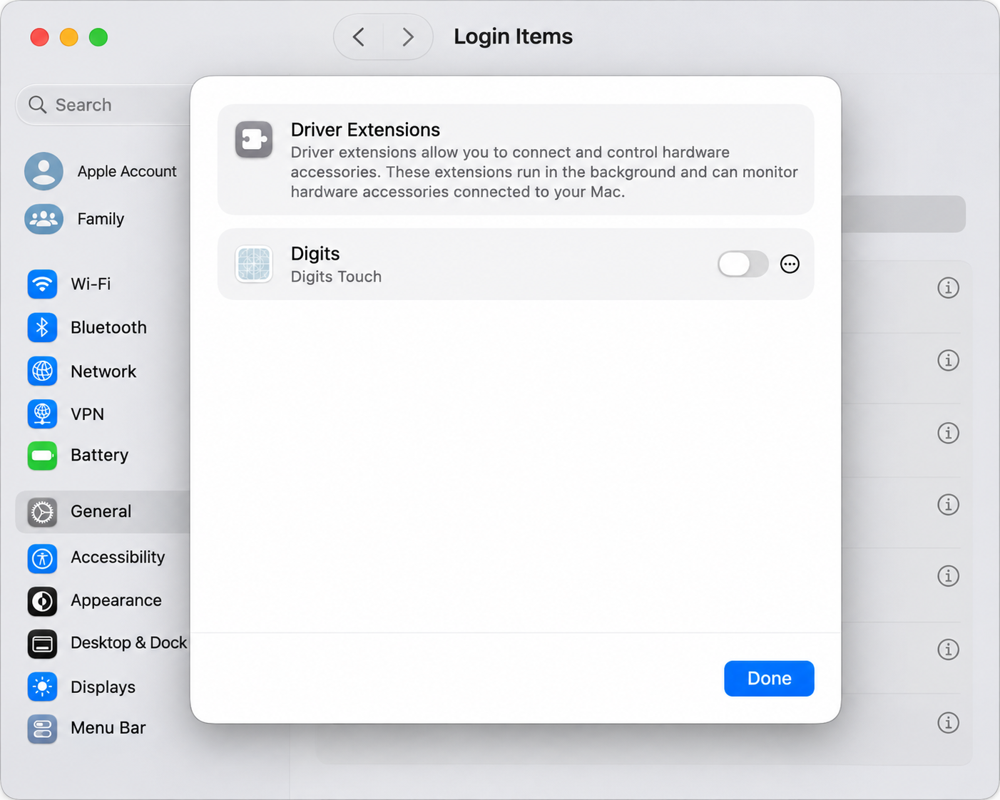
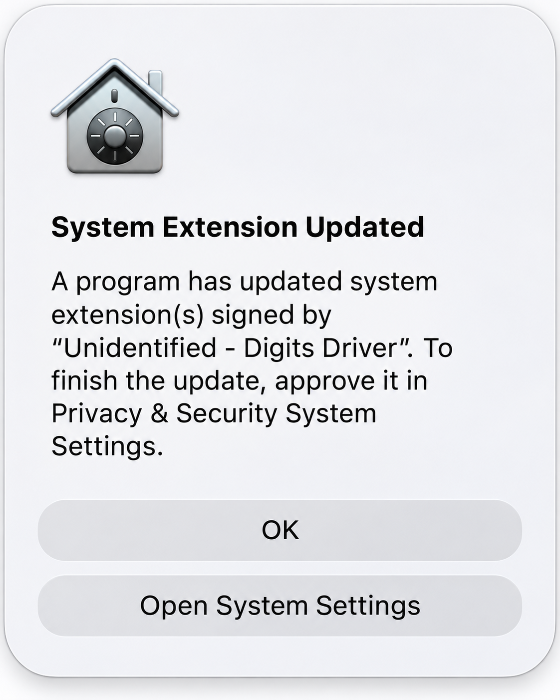
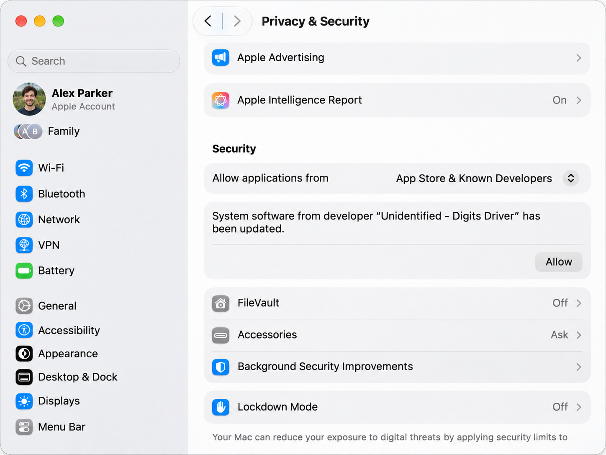
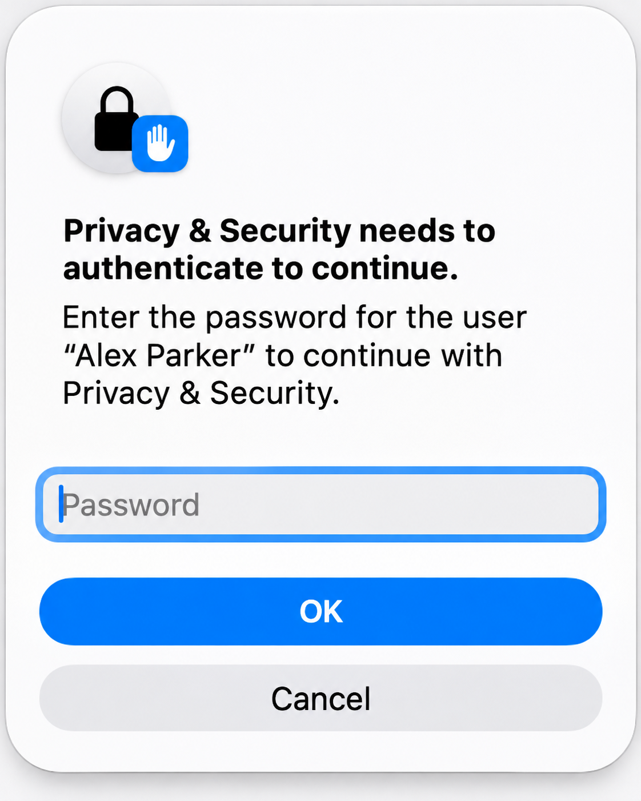

# Digits

> # ⚠️ INSTALL AT YOUR OWN RISK
>
> **This is highly experimental software that requires disabling SIP, selecting Permissive Security, and allowing an unsigned kernel extension. These are substantial reductions in macOS security protections. This is not a normal, Apple-approved app installation.**
>
> **During development, I experienced crashes, complete freezes, and situations that required reinstalling macOS. The current build works on my tested setup, but it may behave differently on yours. Installation, removal, OS updates, and restarting can all expose problems. You could lose data, lose access to your Mac, or need to recover/reinstall macOS.**
>
> **Make a complete backup first. Do not install this on a Mac you cannot afford to recover. Install only if you understand these changes, accept the risks, and can restore your own system.**
>
> **Digits is provided “as is,” without warranties or guarantees. You are responsible for deciding whether to install it and for any security changes, troubleshooting, recovery, or resulting damage or loss. To the extent permitted by applicable law, the developer accepts no liability for damage, data loss, downtime, security consequences, or recovery costs arising from its use. If you do not accept these conditions, do not install it.**

> ## OWNER REPACKAGING REQUIRED — NOT A PUBLIC INSTALLABLE BUILD
>
> **The binaries in this folder are reference artifacts for the repository owner's registered test Mac. They will not work on another, unregistered Mac without the repository owner updating the provisioning profiles, re-signing and repackaging them. Making this repository public does not authorize additional Macs. Contact the repository owner before attempting installation.**
>
> **Provisioning alone is not enough: the owner must also confirm that your exact macOS kernel, USB controller and device route are supported. The risk disclaimer still applies to a repackaged test build.**

**Native touch that works as it should.**

Digits brings independent multitouch to the tested USB touchscreen on macOS. Touch the display without moving your regular mouse pointer away from another screen. The Digits app lets you choose the touch display, open the full-screen Tester, or remove the entire installation.

## Reference binaries

**[Download the password-protected Digits macOS 27.3 ZIP](Digits-macOS-27.3.zip).** Contact the repository owner to confirm compatibility, arrange provisioning and repackaging, and obtain the archive password. The password alone does not authorize another Mac.

Extract the ZIP to access **Digits Installer 0.1.4.dmg**. That disk image contains the complete offline installer and all three components; no separate component download is needed. This guide and its screenshots are public so you can review the requirements before requesting access.

This folder contains the **macOS 27.3 build only**. macOS 27.2, 27.0 and 26 compatibility builds are being investigated separately and are not included. Recompiling with a lower deployment target does not replace the required kernel/controller port.

This is **extremely experimental software**, not a generally compatible or Apple-approved release. The current development-signed app and DriverKit extension are provisioned for specific registered Macs. Another Mac needs matching provisioning/signing **as well as** a compatible Driver build. A download alone does not make this build installable on every Mac.

## Private testing: authorizing another Mac

Giving someone access to the private GitHub repository does not authorize their Mac to run this development-signed build. Before sharing with a new tester:

1. Collect their **Provisioning UDID** privately from System Information → Hardware. This is a device identifier, not an account password, and does not grant remote access.
2. Register the Mac in Apple Developer → Certificates, Identifiers & Profiles → Devices.
3. Regenerate the app and DriverKit development profiles with every intended test Mac selected, then re-sign from the extension outward and refresh the installer payload hashes and package. A source recompilation is normally unnecessary solely to add a device.
4. Publish that refreshed installer for newly authorized testers. Existing testers can keep their installed working version.
5. Separately check the tester's exact kernel, hardware/controller and USB route. Provisioning does not remove the Driver's compatibility restrictions.

Apple documents [registering a device](https://developer.apple.com/help/account/devices/register-a-single-device/) and [creating DriverKit development profiles](https://developer.apple.com/help/account/provisioning-profiles/create-a-driverkit-development-provisioning-profile/). Registration is a development-signing requirement; a future Developer ID distribution with the required Apple-authorized DriverKit entitlements is a different release path. No private signing keys or Apple account credentials should be shared.

## What is included?

| Component | Version | Purpose |
| --- | --- | --- |
| Digits Installer | 0.1.4 | Guides display selection, installation, approvals, reinstall and uninstall. |
| Digits | 0.2.7 | Display binding, complete uninstall, and the built-in Digits Tester. |
| Digits Touch | 0.1.6 | Receives the physical digitizer reports and translates them into native macOS HID touch. |
| Digits Driver | 0.2.4 | Prepares the controller during USB startup and restores the saved display binding. |

The installer is self-contained. It does not fetch components from the internet. Once installed and approved, the drivers run without keeping Digits open. No persistent helper, touch-forwarding service or login item is required.

## Before you install

Use a test Mac with a current backup. This build uses a kernel extension and requires reduced system protections; earlier development attempts caused crashes. The installer does not change your security policy for you.

The published Driver is deliberately restricted to:

- Apple silicon and the tested `AppleT8142USBXHCI` controller family.
- USB controller `27C0:0859`, revision `0150`, at the guarded route `0x00140000`.
- Darwin kernel `27.3.0`, built October 30, 2026, with `xnu-13432.60.57~99/RELEASE_ARM64_T6050`.
- Reference kernel collection SHA-256 `d1003b5143ffd88439b4d45b6017f587171cfe6855660bed05370a2ea5db9fe9`.
- SIP disabled, **Permissive Security**, and third-party kernel extensions enabled. **Reduced Security alone is insufficient for this unsigned build.**

Check the current kernel in Terminal with `uname -v`. The package rejects a different kernel. A matching marketing version such as “27.3” is not enough to establish compatibility. An OS update may require another compatible Driver build. This release makes no compatibility claim for Intel Macs, other USB routes/controllers, or other touchscreen products.

The app and Touch use Apple Development signatures, not distribution signatures. Their current profiles authorize one host Mac and four Touch test devices; they expire on November 11, 2027 and June 21, 2027 respectively. The KEXT and component PKGs are unsigned. The DMG is not notarized. Do not disable Gatekeeper globally to compensate for incompatible signing or provisioning.

### Prepare security settings, if needed

Do this only after confirming that your Mac is eligible for this experimental build and you accept the security changes. If it is already configured correctly, skip this section.

1. Shut down the Mac. Hold the power button until startup options appear, then select **Options → Continue** to enter the Recovery environment paired with the macOS installation you intend to test.
2. Open **Utilities → Terminal** in Recovery. Use the following commands, following the local prompts and selecting the correct macOS volume if you have more than one installation:

```sh
csrutil disable
bputil -n -k
```

3. Restart into macOS. These are separate preparation steps; the Digits installer never runs them. They are not part of the installer's single final restart.

The `bputil` options select Permissive Security and enable kernel extensions. Apple documents the security model in [Startup Disk security policy control](https://support.apple.com/guide/security/sec7d92dc49f/web) and [Securely extending the kernel in macOS](https://support.apple.com/guide/security/sec8e454101b/web). The commands are documented in the Mac's own `csrutil` and `bputil` manuals. Permissive Security is intended for this kind of development experiment, not an endorsement that the build is ready for production.

## Install, step by step

Keep the touchscreen connected to the tested Mac port throughout setup. Complete each approval before continuing. The installer may ask for your password more than once because file installation, DriverKit approval and kernel-cache authorization are separate macOS operations.

### 1. Open the installer

Open **Digits Installer 0.1.4.dmg**. Copy **Digits Installer.app** to a writable folder, such as your Desktop, and open that copy. Read the first screen and click **Next**.

If macOS blocks opening a downloaded, non-notarized app, inspect **System Settings → Privacy & Security** for its normal **Open Anyway** action. This is separate from driver approval and does not resolve a provisioning or kernel mismatch. Apple explains that opening flow in [Safely open apps on your Mac](https://support.apple.com/102445).

If Digits is already present, the first screen offers **Reinstall** or **Uninstall**. Choose Reinstall to replace the installation and make a fresh display selection. It performs cleanup and setup without a middle reboot; restart once at the end.

### 2. Choose the touchscreen display

Select the physical display that contains the digitizer. The list shows the display name, pixel resolution, and UI resolution in points. Click **Install**.

The choice is saved on this Mac; no developer's display UUID is shipped in the download. Binding to a display other than the digitizer's own display has not been tested.

### 3. Install Digits

Approve the administrator prompt when asked. The installer copies Digits into **Applications** and saves the display association. After success, it waits three seconds and slides to the next step automatically.

### 4. Allow Digits Touch

Approve the macOS DriverKit request. If a dialog offers **Open System Settings**, choose it.

If you clicked OK or dismissed it, open **System Settings → General → Login Items & Extensions**. Find **Extensions → Driver Extensions**, then enable **Digits / Digits Touch**. Return to the installer and let it verify acceptance.



The images in this guide illustrate the approval screens. Account names, layout and wording can differ. In the example above, the switch is off; turn it on when approving Digits Touch.

### 5. Allow Digits Driver and finish cache authorization

The next step installs Digits Driver. If macOS presents the extension-updated dialog, choose **Open System Settings**.



If you dismissed it, open **System Settings → Privacy & Security**, scroll down to **Security**, and click **Allow** beside the Digits Driver message.



When macOS offers to restart, choose **Restart Later**. Watch for the **separate password confirmation** that authorizes the startup/kernel-cache update, and finish it using the account macOS names.



**Do not restart before that confirmation finishes.** The administrator prompt used to launch installation is not the same authorization. Do not enable the root account or invent a “System Administrator” password. If a prompt names the wrong account, cancel and retain the diagnostic message.

Return to the installer. Confirm that the separate password step finished, then use **Check Approval**. The installer proceeds after confirmation; successful stages remain visible for three seconds before advancing.

### 6. Restart once

On the final screen, click **Reboot**, or choose Restart Later and restart manually when ready. Leave the touchscreen connected. macOS completes the driver changes during startup.

After logging in, open **Applications → Digits**. The footer should show Digits Touch active and Digits Driver armed. Touch should continue working after you close Digits.

## Try Digits Tester

Click **Tester** in Digits. The button becomes available when the Driver is loaded and armed, Touch is ready, and the display is bound. Tester opens full-screen on the bound display; **Esc** leaves full screen; use **Close** to close Tester.

- Touch points appear in different translucent colors.
- Drag the tile with one or two fingers; pinch to zoom and turn to rotate.
- Tap the tile to make it bounce. Repeated taps make it burst and reassemble.
- Counters show drag, pan, zoom and turn; taps for one through ten fingers; and swipes for one through five fingers.
- The floating toolbar controls touch markers, counters and the live colored **Touch Stream**. You can save a snapshot.

The current installer/app workflow and native touch were confirmed working by the project owner on the measured setup. App uninstall was also verified by checking that installed app, driver, settings and receipts were gone. This is a successful experimental test, not qualification for every boot, sleep/wake, Mac or application. FileVault's preboot unlock screen is outside these drivers; loginwindow behavior and other hardware remain unqualified.

## Change the bound display

Open **Digits → Rebind Display**, choose the display, and click **Use This Display**. Follow the app's restart instructions so the saved association can be republished for the drivers. Changing screen resolution does not by itself imply that its UUID changed.

## Uninstall

Use **Digits → Uninstall Digits**, or choose **Uninstall** on the installer's first screen. Follow each macOS approval/password prompt, keep the app open until removal completes, then restart once.

Removal clears the installed Digits app, Touch registration, Driver files, binding, installed preferences, caches, logs and package receipts. Your downloaded installer, project folders and research captures are not searched or deleted. Cached or running system components can remain until the final restart. Never try to force-unload the running kernel extension or manually delete files in `/Library/SystemExtensions`.

Uninstalling Digits does not restore SIP or startup security policy. After removal and restart, any security-policy restoration is a separate Recovery operation; consult Apple's security guidance for the macOS installation you are using.

## Troubleshooting

**Only single-touch or mouse input:** check the Driver's loaded/armed state, the exact kernel and USB port, and that all cache/password approvals completed. Reboot after installation. Do not run an additional feeder, old shim or another version of the drivers alongside this release.

**Touch active but the screen does not react:** verify the display binding in Digits and restart if the association changed. The app may be closed after the drivers and binding are ready.

**DriverKit approval is missing:** use the Driver Extensions path shown above. System Extensions error 4 can have multiple causes, including app/extension identity, signing or stale registered copies; it is not evidence that touch is working. Keep the exact error for diagnosis rather than repeatedly installing different versions.

**Cache authorization fails or times out:** do not treat the operation as complete. Leave the diagnostic message intact and retry from the current Digits app/installer. Do not enter a root password or assume a generic System Settings button will fix this separate password request.

**Another Mac or macOS release:** the signing profiles and kernel/controller guards may reject it. Another binary must be prepared and validated for that setup; changing a compilation target does not establish runtime compatibility.

## Files and verification

The **password-protected ZIP is the public download**. After extraction, its DMG is the recommended installer. The enclosed `Components` folder contains the standalone app ZIP and frozen component PKGs for reference/manual workflows.

**Do not run the standalone Touch 0.1.6 PKG after the main installer.** It includes its historical Digits 0.1.6 setup app and would replace the newer Digits 0.2.7 app. The main installer embeds the same working Touch extension inside the latest app and avoids that downgrade.

The public `SHA256SUMS` beside the ZIP records hashes for the ZIP, this guide and its screenshots. To verify the archive on macOS:

```sh
shasum -a 256 "/path/to/Digits-macOS-27.3.zip"
```

Compare the result with the ZIP entry in `SHA256SUMS`. When the complete public folder is downloaded, run `shasum -a 256 -c SHA256SUMS` from that folder to check its files. The protected archive also contains a separate `MacOS-27.3/SHA256SUMS` for the original installer and component payloads.

This guide records the versions, compatibility limits and development-signing status. There is no machine-specific display binding in the bundled installer.

## Source and Apple approval

Source: [Andre-s-World/digits](https://github.com/Andre-s-World/digits). Binary repository: [Andre-s-World/digits-binary](https://github.com/Andre-s-World/digits-binary).

The current early USB hook still depends on private Apple implementation details under an explicit development exception. The app, installer and Touch work do not remove that existing dependency. Packaging and development signing do not mean Apple has approved this driver; a broadly distributable, supported-API release is future work.
